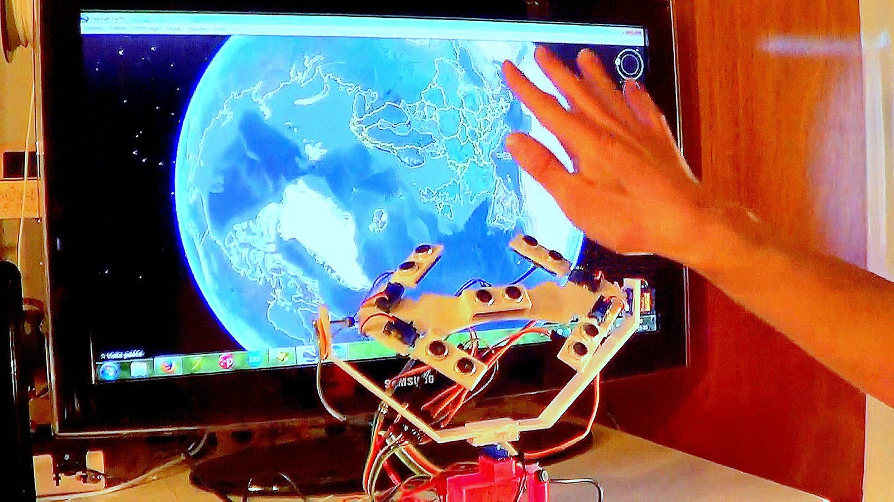

# 3D Contactless Ultrasonic Mouse (Arduino Leonardo)

Control your computer by waving your hand. Five HC-SR04 ultrasonic sensors on a servo-driven head follow your hand left, right, up and down, and an Arduino Leonardo turns that into USB mouse movement; moving closer or further scrolls, and a finger snap clicks through a small microphone circuit. A fun hand-tracking experiment to build and tune. Remix of [3D Contactless Mouse (Interactive 3D Position Sensor)](https://www.instructables.com/3D-Contactless-Mouse-Interactive-3D-Position-Senso/) by birdyberth, updated/refurbished for modern use. Print files unchanged.

## Install and build guide

### What you are building

A small servo-driven sensor head with five HC-SR04 ultrasonic sensors follows your hand. One sensor looks straight ahead, four sit on tilting wings around it. Two servos turn the whole head left/right (theta) and up/down (phi); four more servos tilt the wings. An Arduino Leonardo works out where your hand is and acts as a USB mouse: moving your hand away from the centre moves the cursor, moving closer or further scrolls, and a finger snap picked up by a small microphone circuit clicks.

It is a fun experiment rather than a replacement for a desk mouse: the sensors update about 17 times a second and the micro servos are slow.

Printed parts (PLA):

- `frame.stl` - central frame
- `contour_servo.stl`, `contour_vis.stl` - the two sides of the mounting bracket (servo side and screw side)
- `dessous_contour.stl`, `dessous_contour2.stl` - small base pieces of the bracket
- `base2.stl` - base that holds the theta servo
- `SR04_holder_v3.stl` - sensor holder, print five (`SR04_holder_v2.stl` is the older version; use one or the other)

### Parts you buy separately

All shop parts are in the Bill of Material PDF. A few small items come from your parts drawer:

- **Pivot for the bracket:** the original uses a small rod glued to the frame turning in a small roller (taken from an old cassette player) on the tip of a screw. Any small roller or bearing that spins freely on an M3 screw tip works the same way.
- **Counterweight:** the original glues three 25-cent coins under the nuts to balance the head. Use any coins or washers of similar weight and adjust until the head stays where the servo puts it.

### Step 1 - Install the software and flash the board first

1. Install the Arduino IDE (2.x). Select the board **Arduino Leonardo** (Arduino AVR Boards, installed by default).
2. Install the **NewPing** library (by Tim Eckel) with the Library Manager. `Servo` comes with the IDE.
3. Open `source/upstream/files/test_servos.ino` from this repository, upload it, and use it in Step 5 to find the flat servo positions.
4. Open `echolocator3d.ino`. **Add the line `#include <Mouse.h>`** below `#include <NewPing.h>` (line 8). The sketch uses `Mouse.begin()`, `Mouse.move()` and `Mouse.press()`; current Arduino IDEs only compile them with that include.
5. Upload it later, after the servo positions are set (Step 5). While it runs, the Leonardo really moves your cursor; keep the USB cable within reach so you can unplug it.

### Step 2 - Wiring

The sketch uses one pin per ultrasonic sensor: each HC-SR04 has separate Trig and Echo pins, so **bridge Trig and Echo** on every sensor (a short wire or solder bridge) and connect that joint to the Arduino pin.

| Arduino pin | Connects to |
|---|---|
| D2 | base servo (theta, left/right) signal |
| D3 | not used (kept free on purpose) |
| D4 | up-left wing servo signal |
| D5 | down-left wing servo signal |
| D6 | down-right wing servo signal |
| D7 | up-right wing servo signal |
| A0 | tilt servo (phi, up/down) signal |
| D8 | up-left sensor Trig+Echo |
| D9 | down-left sensor Trig+Echo |
| D10 | down-right sensor Trig+Echo |
| D11 | up-right sensor Trig+Echo |
| D12 | middle sensor Trig+Echo |
| A1 | click output of the sound circuit (555 pin 3) |

Power:

- All five sensors take 5 V from the Arduino 5V pin.
- **All six servos take 5 V from the separate 5 V supply** (through the DC jack screw terminal). Six servos moving at once draw far more than the Leonardo's USB supply can give.
- Connect all grounds together: Arduino GND, supply -, servo GND, sensor GND.

Build the wiring on the protoshield; its mini breadboard has no power rails, so plan where the 5 V and GND wires go before you start.

### Step 3 - Sound click circuit (on the protoshield)

This is the circuit from the original schematic. It turns a finger snap into a short high pulse on A1.

- Microphone: the electret capsule's + lead goes to 5 V through **R1 4.7 kOhm**; its - lead goes to GND (check the marking: the lead connected to the case is -).
- The microphone signal passes through **C1 10 nF** into a divider of **R2 4.7 kOhm** (to the mic side) and **R3 10 kOhm** (to GND); the divider point feeds the **LM386** + input. LM386 - input to GND; LM386 supply 5 V and GND.
- LM386 output through **C2 10 nF** into the **555** trigger (pin 2).
- 555 as a one-shot: pins 4 and 8 to 5 V, pin 1 to GND, **R4 100 kOhm** from 5 V to pins 6 and 7, **C3 1 uF** from pins 6/7 to GND (electrolytic: + to pins 6/7), **C4 10 nF** from pin 5 to GND. Pin 3 (output) to Arduino A1.

R4 and C3 set a pulse of roughly 1.1 x 100 kOhm x 1 uF = about 0.1 s. The original notes that the sensitivity is hard to get right; you can replace the R2/R3 divider with a 10 kOhm trimmer to tune it. If the mouse clicks on its own, the trigger is too sensitive: lower the divider ratio or move the microphone away from the servos.

### Step 4 - Mechanical assembly

The original uses hot glue throughout. It holds PLA well and can be removed again if a part goes on wrong.

1. **Sensors:** put a little hot glue on each sensor's crystal and glue it into a holder. Glue a servo horn to the side of each wing holder.
2. **Central frame:** glue the four wing servos into their pockets on the frame, centred, and tape or glue their wires to the back. Glue the middle sensor in the centre.
3. **Base:** pass the theta servo's wire through the hole in the base and glue the servo in. Clamp the base to your desk if you like.
4. **Bracket:** glue the two bracket sides to the small base pieces. Fix a servo horn to the theta servo and glue the bottom of the bracket onto it; fill the hole at this joint with hot glue for strength. Glue the phi servo into the square hole at the top of one bracket side, gear facing inwards.
5. **Pivot:** on the other bracket side, glue two M3 nuts into the top, thread in the M3 screw and fix your roller on its tip. Glue the small rod to the frame, slide it into the roller and tighten the screw until the frame is held.
6. **Counterweight:** glue your coins or washers below the nuts to balance the servo on the other side.
7. Fit the wing sensors' horns onto the wing servos.

### Step 5 - Set the servo positions

1. With `test_servos.ino` running, the wing servos go to 100, 95, 100 and 95 degrees, theta to 90 and phi to 90.
2. Change the numbers in `test_servos.ino` and re-upload until all five sensors face straight ahead in one plane.
3. Copy your wing values into the "Servo start angles" block of `echolocator3d.ino` (lines 44-49) and upload it.

### Step 6 - Use it

- Keep your hand 10-30 cm in front of the middle sensor: the cursor moves, no scrolling.
- Closer than about 10 cm scrolls one way, further than about 30 cm the other way.
- Beyond 45 cm (`MAX_DISTANCE`) nothing is detected; the wings sweep to search and the mouse function stops.
- Hand off-centre: the cursor keeps moving in that direction; bring it back to the centre to stop.
- Snap your fingers to click.
- The serial monitor at **115200 baud** prints the sensor flags, all servo angles and the click state on every cycle.

### Troubleshooting

- Board resets or servos twitch when they move: the servos are on the USB 5 V. Move them to the separate supply and share GND.
- A sensor never reacts: check that its Trig and Echo are bridged and on the right pin.
- Compile error about `Mouse`: add `#include <Mouse.h>` (Step 1).
- Cursor runs away when nobody is there: a sensor sees the desk or a wall; point the head at open space.

### Files in this project

- Print: the eight STL files listed above
- Firmware: `source/upstream/files/echolocator3d.ino` and `source/upstream/files/test_servos.ino` in this repository
- Bill of Material PDF with shop links for each part

## Bill of Material and build guide (PDF)

- [Bill of Material (PDF)](docs/3D%20Contactless%20Ultrasonic%20Mouse%20%28Arduino%20Leonardo%29%20-%20remix%20-%20Bill%20of%20Material.pdf) - every part to buy, with shop links.
- [Build Guide (PDF)](docs/3D%20Contactless%20Ultrasonic%20Mouse%20%28Arduino%20Leonardo%29%20-%20remix%20-%20Build%20Guide.pdf)

## Repository contents

- `source/upstream/files/` - the author's original attachments: the eight STL print files and the sketches `echolocator3d.ino` (the mouse) and `test_servos.ino` (servo set-up).
- `source/upstream/images/` - the author's photos from the Instructables page.
- `docs/` - this build guide as Markdown and PDF, the Bill of Material PDF, the upstream file manifest with hashes and the upstream licence record.
- `images/` - cover photo (by birdyberth) and a render of the print files.

## Credits and license

Original design, code, text and photos: birdyberth, 3D Contactless Mouse (Interactive 3D Position Sensor) - https://www.instructables.com/3D-Contactless-Mouse-Interactive-3D-Position-Senso/

Licensed under the [Creative Commons Attribution-ShareAlike 4.0 International (CC BY-SA 4.0)](https://creativecommons.org/licenses/by-sa/4.0/) - see `LICENSE`. The build guide, Bill of Material and parts render in this repository are adaptations shared under the same CC BY-SA 4.0 licence.

Changes in this repository: a rewritten build guide (including the `#include <Mouse.h>` compile fix as an instruction), a current Bill of Material, a render of the print files and this repository layout. The print files and sketches are unchanged.
